  <picture>
    <source media="(max-width: 600px) and (prefers-color-scheme: dark)" srcset="assets/header-narrow-dark.svg">
    <source media="(max-width: 600px)" srcset="assets/header-narrow-light.svg">
    <source media="(prefers-color-scheme: dark)" srcset="assets/header-wide-dark.svg">
    
  </picture>

안녕하세요, 단강입니다. TypeScript와 React로 웹 서비스를 만들고, 지도 위에 데이터를 올리는 화면을 좋아합니다. 요즘은 AI 에이전트 여러 대와 편대를 짜서 개발합니다. 
Hi, I'm Dankang. I build web services with TypeScript and React, I like putting data on maps, and these days I fly in formation with AI agents.

  <picture>
    <source media="(max-width: 600px) and (prefers-color-scheme: dark)" srcset="assets/status-narrow-dark.svg">
    <source media="(max-width: 600px)" srcset="assets/status-narrow-light.svg">
    <source media="(prefers-color-scheme: dark)" srcset="assets/status-wide-dark.svg">
    
  </picture>

## 🧰 탑재 장비 / Payload

<table>
  <tr>
    <td><b>웹</b></td>
    <td>
      
      
      
      
    </td>
  </tr>
  <tr>
    <td><b>데이터</b></td>
    <td>
      
      
      
    </td>
  </tr>
  <tr>
    <td><b>지도</b></td>
    <td>
      
      
    </td>
  </tr>
  <tr>
    <td><b>AI</b></td>
    <td>
      
      
    </td>
  </tr>
  <tr>
    <td><b>배운 것</b></td>
    <td>
      
      
      
    </td>
  </tr>
</table>

## 🤖 AI와 함께 개발 / Co-pilots

혼자 조종하지 않습니다. 매일 AI 에이전트에게 일을 나눠 맡기고, 저는 방향과 최종 확인을 맡습니다.

| 자리 | 누가 | 하는 일 |
| --- | --- | --- |
| 관제탑 | 오케스트레이터 | 요청을 프로젝트별로 나눠 지시합니다 |
| 편대장 | 프로젝트 PM 에이전트 | 일을 작업 단위로 쪼개고 결과를 확인합니다 |
| 기체 | 작업자 에이전트 | 분리된 작업 공간에서 구현하고 PR을 엽니다 |
| 정비 점검 | Codex 리뷰 | 다른 모델이 변경 내용을 다시 검토합니다 |

- Claude Code 에이전트를 여러 저장소에 동시에 띄우는 멀티 에이전트 작업 방식을 씁니다.
- 한 모델이 쓴 코드는 다른 모델이 검토하게 합니다.
- 에이전트가 따르는 규칙과 검증 절차(하네스), 그리고 그 결과를 재는 지표를 다듬는 데 관심이 많습니다.

## ✈ 비행 기록 / Flight log

| 기체 | 임무 |
| --- | --- |
| [DankangNote](https://github.com/DankangE/DankangNote) | Tiptap 에디터로 만드는 노트 SaaS 프로젝트 TypeScript, Next.js, Prisma |
| [GIS2](https://github.com/DankangE/GIS2) | OpenLayers 지도 화면 구현과 코드 해설 JavaScript, OpenLayers |
| [GISrequest](https://github.com/DankangE/GISrequest) | GIS 지점 관리 업무를 만드는 화면 JavaScript |
| [Next_study](https://github.com/DankangE/Next_study) | Next.js 14로 블로그를 만들며 공부한 기록 TypeScript, Next.js |
| [Multicampus](https://github.com/DankangE/Multicampus) | 멀티캠퍼스 국비 과정에서 쌓은 실습 자료 Python, Jupyter |

## 📡 계기판 / Telemetry

  <picture>
    <source media="(max-width: 600px) and (prefers-color-scheme: dark)" srcset="assets/telemetry-narrow-dark.svg">
    <source media="(max-width: 600px)" srcset="assets/telemetry-narrow-light.svg">
    <source media="(prefers-color-scheme: dark)" srcset="assets/telemetry-wide-dark.svg">
    
  </picture>

  <picture>
    <source media="(prefers-color-scheme: dark)" srcset="https://github-profile-summary-cards.vercel.app/api/cards/stats?username=DankangE&amp;theme=github_dark">
    
  </picture>
  <picture>
    <source media="(prefers-color-scheme: dark)" srcset="https://github-profile-summary-cards.vercel.app/api/cards/repos-per-language?username=DankangE&amp;theme=github_dark">
    
  </picture>

  <picture>
    <source media="(prefers-color-scheme: dark)" srcset="https://streak-stats.demolab.com/?user=DankangE&amp;hide_border=true&amp;background=00000000&amp;locale=ko&amp;disable_animations=true&amp;ring=6FA0FF&amp;fire=F2B14A&amp;currStreakNum=EAF1F8&amp;sideNums=EAF1F8&amp;currStreakLabel=6FA0FF&amp;sideLabels=9DB2C8&amp;dates=9DB2C8&amp;stroke=1F3550">
    
  </picture>

## 🛬 착륙 지점 / Landing

포트폴리오는 [dankange.github.io](https://dankange.github.io/)에 있습니다.
